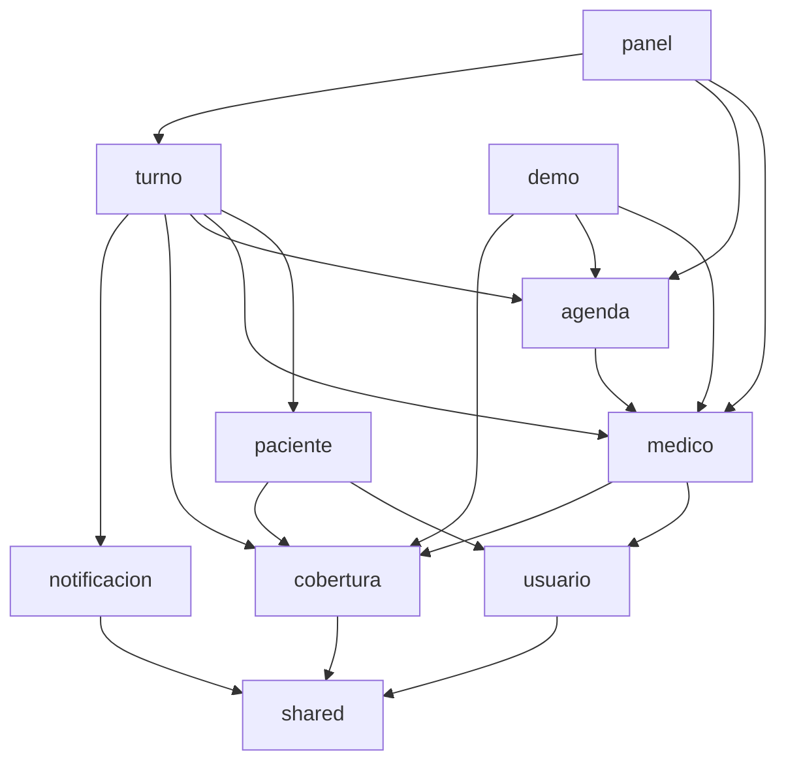
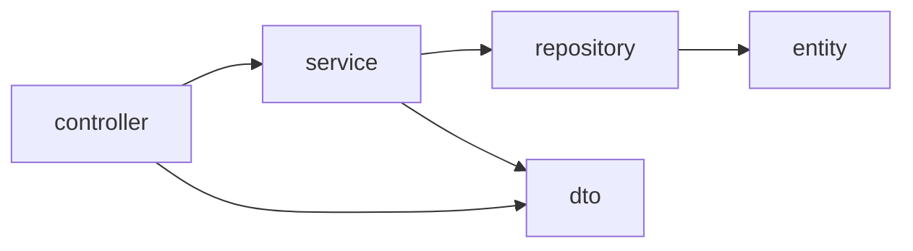
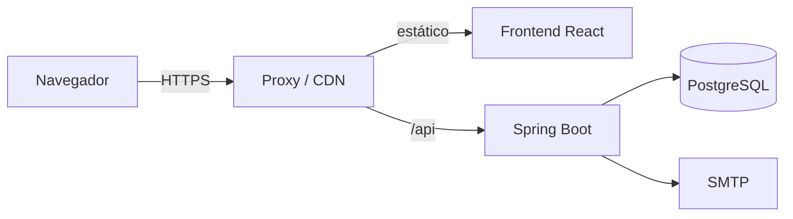

# Arquitectura

## Resumen

La aplicación es un **monolito modular clásico** organizado *package-by-feature*. No usa DDD, arquitectura hexagonal ni microservicios. Cada módulo agrupa sus controladores, servicios, repositorios, entidades y DTOs, y se comunica con los demás por servicios públicos o por entidades del modelo compartido.

- Backend: Spring Boot 4.1.2, Java 21, Spring MVC, Spring Data JPA, Spring Security, Flyway.
- Base de datos: PostgreSQL 17. Persistencia en `timestamptz`, zona de negocio `America/Argentina/Buenos_Aires`.
- Frontend: React + Vite + TypeScript (ver `frontend-turnoApp/`).
- Infra local: Docker Compose con PostgreSQL (host 5433) y Mailpit (1025 / 8025).

## Módulos

| Módulo | Responsabilidad |
| --- | --- |
| `shared` | Entidades base, errores de API, seguridad JWT, configuración, utilidades web. |
| `usuario` | Usuarios, roles, refresh tokens, login de staff y sesión. |
| `paciente` | Pacientes, autenticación por OTP y datos personales. |
| `cobertura` | Obras sociales y planes. |
| `medico` | Médicos, especialidades y coberturas aceptadas. |
| `agenda` | Consultorios, disponibilidad semanal, excepciones y generación de slots. |
| `turno` | Reserva, cancelación, reprogramación, estados y recordatorios. |
| `notificacion` | Registro de notificaciones y envío de emails. |
| `panel` | Endpoints del panel del médico. |
| `demo` | Datos de demostración para el perfil `dev`. |

Dentro de cada módulo los paquetes técnicos son siempre los mismos:

```text
modulo/
├── controller/   endpoints HTTP
├── service/      reglas de negocio y transacciones
├── repository/   interfaces Spring Data JPA
├── entity/       entidades JPA y enums persistidos
└── dto/          records de entrada y salida
```

`shared` se organiza por función (`config`, `security`, `error`, `web`, `entity`) porque no representa un dominio de negocio.

## Dependencias entre módulos



Reglas verificadas por `ModuleBoundariesTest` (ArchUnit):

1. No hay ciclos entre módulos.
2. Los controladores no acceden directamente a repositorios: siempre pasan por un servicio.

## Capas dentro de un módulo



- El controlador valida la entrada (`@Valid`), resuelve el usuario autenticado y delega.
- El servicio concentra reglas de negocio y límites transaccionales.
- El repositorio solo consulta o persiste; no contiene reglas.
- Las entidades no se exponen directamente por HTTP: se mapean a DTOs (records).

## Seguridad

- **Staff (`ADMIN`, `MEDICO`)**: login con email y contraseña. Se emite un *access token* JWT (15 minutos) y un *refresh token* (7 días) en cookie `refresh_token` (`httpOnly`, `SameSite=Strict`, `path=/auth`).
- **Pacientes**: login sin contraseña con DNI + apellido + OTP de 6 dígitos enviado por email. El OTP dura 10 minutos, permite 5 intentos y se limita a 3 envíos cada 15 minutos.
- El *access token* viaja en `Authorization: Bearer <token>`.
- El refresh rota el token: el anterior se revoca al usarse.
- Rutas públicas: `/auth/**`, `/especialidades`, `/obras-sociales`, `/medicos/**`, Swagger y `/error`.
- `/admin/**` exige `ADMIN`; `/medico/**` exige `MEDICO`; `/turnos/**` y `/pacientes/**` exigen `PACIENTE`.

## Configuración

- `application.properties`: configuración común y valores por defecto.
- `application-dev.properties`: PostgreSQL local, Mailpit, datos demo y OTP visible en logs.
- `application-prod.properties`: variables de entorno obligatorias.
- Secretos por entorno: `APP_JWT_SECRET`, `APP_ADMIN_PASSWORD`, `DB_URL`, `DB_USERNAME`, `DB_PASSWORD`, `MAIL_*`.

## Persistencia y migraciones

- Flyway aplica `db/migration/V1__schema_inicial.sql`, `V2__catalogos_iniciales.sql` y las migraciones posteriores.
- `spring.jpa.hibernate.ddl-auto=validate`: Hibernate nunca crea ni modifica el esquema.
- Una migración aplicada no se edita: se agrega una nueva.
- La zona horaria de la JVM y de Hibernate es UTC; las fechas de negocio se convierten a `America/Argentina/Buenos_Aires` en la capa de servicio y en la API.

## Pruebas

- **Unitarias**: sin Docker. Ejemplo: `SlotServiceTest` valida generación de slots, excepciones, reservas y ventana de anticipación.
- **Integración**: Testcontainers con PostgreSQL 17. Se omiten si Docker no está disponible (`@Testcontainers(disabledWithoutDocker = true)`).
- **Arquitectura**: ArchUnit valida ciclos entre módulos y que los controladores no usen repositorios.
- No se usa H2: el esquema depende de PostgreSQL (índices únicos parciales, `timestamptz`).

## Despliegue



El backend es stateless: los access tokens se validan en memoria y los refresh tokens se guardan hasheados en la base. Se puede escalar horizontalmente detrás de un balanceador, siempre que todos los nodos compartan la misma base y el mismo `APP_JWT_SECRET`.
