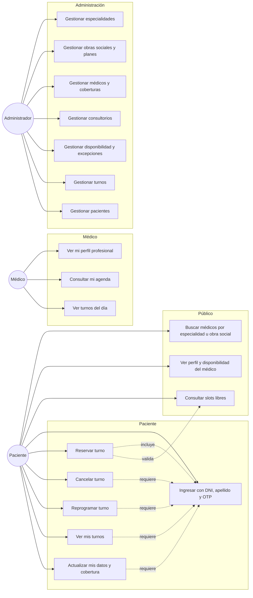

# Casos de uso

## Detalle de casos principales

### CU5 — Reservar turno

- **Actor**: paciente autenticado.
- **Precondiciones**: sesión con OTP verificada; el médico está activo; el horario está dentro de los próximos 90 días y con 2 horas de anticipación.
- **Flujo principal**: elige médico y slot, completa el motivo, confirma. El sistema valida el slot, determina cobertura, guarda el turno y envía email.
- **Alternativas**: el slot se ocupó (409); el médico no acepta la cobertura y el paciente pidió obra social (409); no hay sesión (401).

### CU6 — Cancelar turno

- **Actor**: paciente autenticado.
- **Precondiciones**: el turno pertenece al paciente, está activo y faltan 24 horas o más.
- **Resultado**: estado `CANCELADO_PACIENTE`, slot liberado, email de cancelación.

### CU7 — Reprogramar turno

- **Actor**: paciente autenticado.
- **Precondiciones**: las mismas que cancelar.
- **Resultado**: nuevo `fechaHora`, consultorio y duración; estado `CONFIRMADO`; email de reprogramación.

### CU18 — Gestionar turnos

- **Actor**: administrador.
- **Acciones**: listar con filtros por fecha, médico y estado; marcar `ATENDIDO` o `AUSENTE`; cancelar desde la clínica con motivo.
- **Resultado**: el paciente recibe email cuando la clínica cancela.
