# Diagrama de clases

Vista simplificada del modelo de dominio y de los servicios principales. Los getters/setters de Lombok y los detalles de persistencia se omiten para mantener la legibilidad.

```mermaid
classDiagram
    class BaseEntity {
        +UUID id
        +Instant creadoEn
        +Instant actualizadoEn
    }

    class Rol {
        <<enumeration>>
        ADMIN
        MEDICO
        PACIENTE
    }

    class EstadoTurno {
        <<enumeration>>
        PENDIENTE
        CONFIRMADO
        ATENDIDO
        CANCELADO_PACIENTE
        CANCELADO_CLINICA
        AUSENTE
        +esCancelable() boolean
    }

    class TipoCobertura {
        <<enumeration>>
        OBRA_SOCIAL
        PARTICULAR
    }

    class Usuario {
        +String email
        +String passwordHash
        +Rol rol
        +String nombre
        +String apellido
        +boolean activo
        +nombreCompleto() String
    }

    class Paciente {
        +String nombre
        +String apellido
        +String dni
        +LocalDate fechaNacimiento
        +String telefono
        +String email
        +String numeroAfiliado
        +boolean consentimientoDatos
    }

    class Medico {
        +String nombre
        +String apellido
        +String matricula
        +int duracionTurnoMin
        +BigDecimal precioParticular
        +String biografia
        +boolean activo
        +nombreCompleto() String
    }

    class Especialidad {
        +String nombre
        +int duracionDefaultMin
        +boolean activo
    }

    class ObraSocial {
        +String nombre
        +String codigo
        +boolean activo
    }

    class Plan {
        +String nombre
        +String codigo
        +boolean activo
    }

    class MedicoCobertura {
        +UUID id
        +Instant creadoEn
    }

    class Consultorio {
        +String nombre
        +String ubicacion
        +boolean activo
    }

    class Disponibilidad {
        +int diaSemana
        +LocalTime horaDesde
        +LocalTime horaHasta
        +LocalDate vigenteDesde
        +LocalDate vigenteHasta
        +boolean activo
    }

    class ExcepcionAgenda {
        +LocalDate fechaDesde
        +LocalDate fechaHasta
        +boolean todoElDia
        +LocalTime horaDesde
        +LocalTime horaHasta
        +String motivo
    }

    class Turno {
        +OffsetDateTime fechaHora
        +int duracionMin
        +EstadoTurno estado
        +TipoCobertura tipoCobertura
        +String numeroAfiliado
        +BigDecimal precio
        +String motivo
        +String canal
        +String canceladoMotivo
    }

    class Notificacion {
        +UUID turnoId
        +TipoNotificacion tipo
        +String destinatario
        +EstadoNotificacion estado
        +Instant enviadoEn
        +String error
    }

    class RefreshToken {
        +String tokenHash
        +Instant expiraEn
        +boolean revocado
    }

    class CodigoOtp {
        +String codigoHash
        +Instant expiraEn
        +boolean usado
        +int intentos
    }

    class AuthService {
        +login(LoginRequest) Tokens
        +refrescar(String) Tokens
        +cerrarSesion(String)
        +me(UUID) UsuarioResponse
    }

    class PacienteAuthService {
        +solicitarOtp(OtpRequest) OtpSolicitadoResponse
        +verificarOtp(OtpVerifyRequest) Tokens
    }

    class TokenService {
        +generar(Usuario) Tokens
        +refrescar(String) Tokens
        +cerrarSesion(String)
    }

    class MedicoService {
        +buscar(UUID, UUID, UUID) List~MedicoResumenResponse~
        +crear(CrearMedicoRequest) MedicoResponse
        +actualizar(UUID, ActualizarMedicoRequest) MedicoResponse
        +aceptaCobertura(UUID, UUID, UUID) boolean
    }

    class AgendaService {
        +crearDisponibilidad(UUID, DisponibilidadRequest) DisponibilidadResponse
        +crearExcepcion(UUID, ExcepcionRequest) ExcepcionResponse
    }

    class SlotService {
        +slots(UUID, LocalDate) List~SlotResponse~
        +validarSlot(UUID, OffsetDateTime) SlotResponse
    }

    class TurnoService {
        +reservar(UUID, ReservarTurnoRequest) TurnoResponse
        +cancelar(UUID, UUID, String) TurnoResponse
        +reprogramar(UUID, UUID, OffsetDateTime) TurnoResponse
        +cambiarEstado(UUID, EstadoTurno, String) TurnoResponse
    }

    class NotificacionService {
        +enviarConfirmacion(DatosTurnoNotificacion)
        +enviarRecordatorio(DatosTurnoNotificacion)
        +enviarCancelacion(DatosTurnoNotificacion)
        +enviarReprogramacion(DatosTurnoNotificacion)
    }

    BaseEntity <|-- Usuario
    BaseEntity <|-- Paciente
    BaseEntity <|-- Medico
    BaseEntity <|-- Especialidad
    BaseEntity <|-- ObraSocial
    BaseEntity <|-- Plan
    BaseEntity <|-- Consultorio
    BaseEntity <|-- Disponibilidad
    BaseEntity <|-- ExcepcionAgenda
    BaseEntity <|-- Turno

    Usuario "1" --> "0..1" Paciente : perfil
    Usuario "1" --> "0..1" Medico : perfil
    Usuario "1" --> "0..*" RefreshToken
    Usuario "1" --> "0..*" CodigoOtp

    Paciente "0..*" --> "0..1" ObraSocial
    Paciente "0..*" --> "0..1" Plan

    ObraSocial "1" --> "0..*" Plan
    Medico "1" --> "0..*" MedicoCobertura
    ObraSocial "1" --> "0..*" MedicoCobertura
    Plan "0..1" --> "0..*" MedicoCobertura

    Medico "1" --> "0..*" Especialidad : especialidades
    Medico "1" --> "0..*" Disponibilidad
    Consultorio "1" --> "0..*" Disponibilidad
    Medico "1" --> "0..*" ExcepcionAgenda

    Medico "1" --> "0..*" Turno
    Paciente "1" --> "0..*" Turno
    Consultorio "1" --> "0..*" Turno
    Turno "0..*" --> "0..1" ObraSocial
    Turno "0..*" --> "0..1" Plan
    Turno "1" --> "0..*" Notificacion : turnoId

    AuthService --> TokenService
    PacienteAuthService --> TokenService
    PacienteAuthService --> Paciente
    TurnoService --> SlotService
    TurnoService --> MedicoService
    TurnoService --> NotificacionService
    SlotService --> MedicoService
    AgendaService --> MedicoService
```

## Notas de diseño

- `Turno` guarda una copia de `duracionMin` para que un cambio posterior en la duración del médico no altere turnos ya reservados.
- `Notificacion` referencia `turnoId` como UUID y no como relación JPA: así el módulo `notificacion` no depende de `turno`.
- `MedicoCobertura` permite dos formas de aceptar una obra social: sin plan (acepta todos) o con un plan específico.
- `EstadoTurno.esCancelable()` centraliza la regla de qué estados se pueden cancelar o reprogramar.
