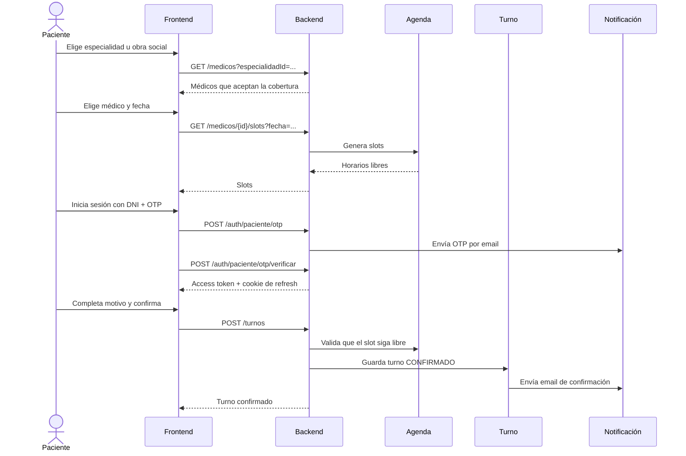
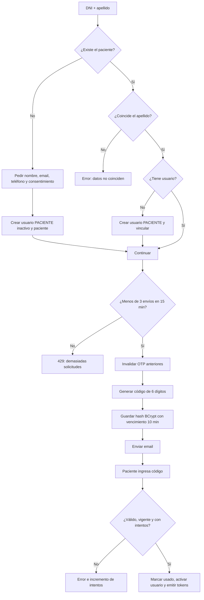
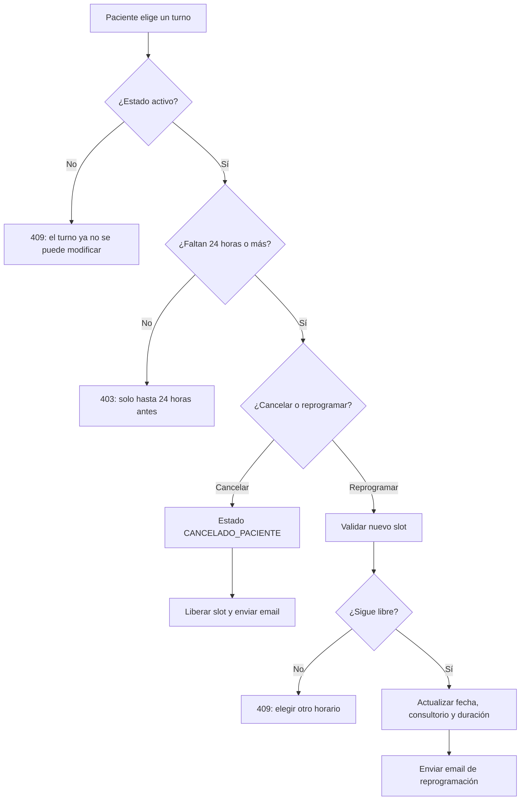
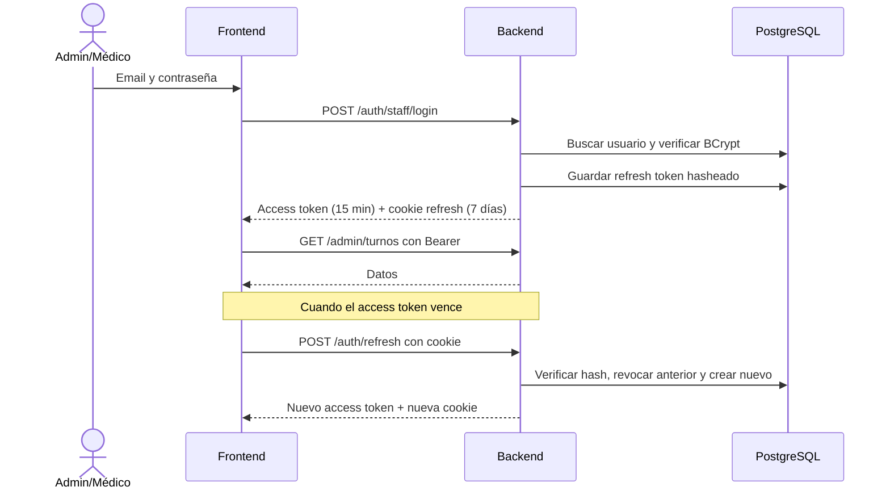
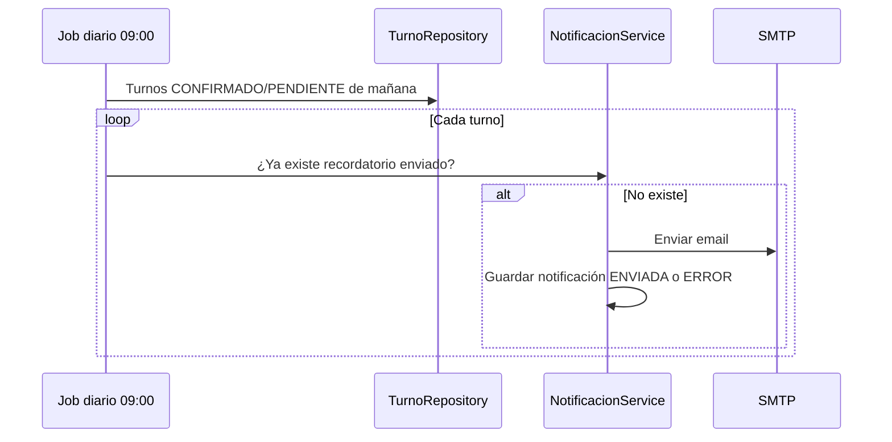
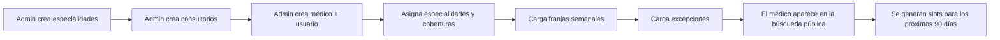

# Flujos

## 1. Búsqueda y reserva de turno

Puntos clave:

- El slot se vuelve a validar al reservar: entre la consulta y la confirmación pudo ocuparse.
- El índice único parcial evita la doble reserva aunque dos personas confirmen a la vez.
- Si el médico no acepta la cobertura del paciente, el turno se crea como `PARTICULAR` con el precio del médico.
- La reserva exige al menos 2 horas de anticipación y como máximo 90 días.

## 2. Login de paciente con OTP

## 3. Cancelación y reprogramación

El turno cancelado deja de ocupar el índice único parcial y el horario vuelve a aparecer en `/slots`.

## 4. Sesión de staff

## 5. Recordatorio 24 horas antes

El job corre con la zona `America/Argentina/Buenos_Aires`. Si el email falla, la notificación queda en `ERROR` y no se reintenta automáticamente en el mismo día.

## 6. Alta de médico y agenda (admin)

## 7. Reprogramación por parte de la clínica

El admin puede cancelar un turno con `PATCH /admin/turnos/{id}/cancelar?motivo=...`. El turno pasa a `CANCELADO_CLINICA`, se libera el slot y se envía email al paciente. No existe todavía un endpoint para que el admin reprograme directamente: se cancela y el paciente reserva un nuevo horario.
