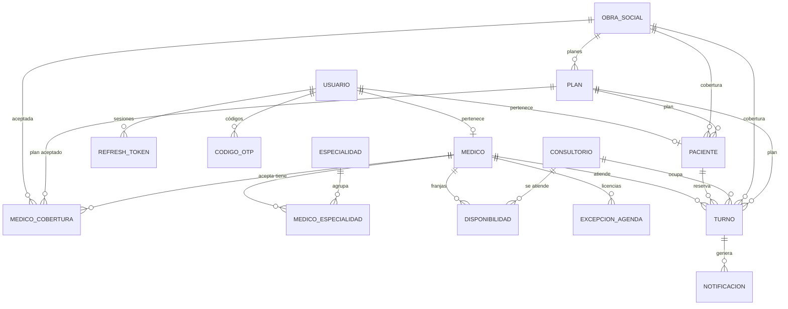

# Modelo de datos

## Diagrama entidad-relación



## Entidades

### `usuario`

Cuenta de acceso. Un usuario puede ser `ADMIN`, `MEDICO` o `PACIENTE`.

| Columna | Tipo | Notas |
| --- | --- | --- |
| `id` | uuid | PK |
| `email` | varchar(255) | Único por `lower(email)` |
| `password_hash` | varchar(100) | Nulo para pacientes |
| `rol` | varchar(20) | `ADMIN`, `MEDICO`, `PACIENTE` |
| `nombre`, `apellido` | varchar(120) | |
| `activo` | boolean | Los pacientes quedan inactivos hasta verificar el OTP |
| `creado_en`, `actualizado_en` | timestamptz | |

### `paciente`

Datos personales y cobertura declarada.

| Columna | Tipo | Notas |
| --- | --- | --- |
| `id` | uuid | PK |
| `usuario_id` | uuid | Único, nullable, FK a `usuario` |
| `dni` | varchar(15) | Único, normalizado sin puntos |
| `fecha_nacimiento` | date | Opcional |
| `telefono`, `email` | varchar | Obligatorios |
| `obra_social_id`, `plan_id` | uuid | Opcionales |
| `numero_afiliado` | varchar(50) | Opcional |
| `consentimiento_datos` | boolean | Ley 25.326 |

### `medico`

Perfil profesional asociado a un usuario con rol `MEDICO`.

| Columna | Tipo | Notas |
| --- | --- | --- |
| `id` | uuid | PK |
| `usuario_id` | uuid | Único, obligatorio |
| `matricula` | varchar(40) | Única |
| `duracion_turno_min` | integer | Duración base de cada slot |
| `precio_particular` | numeric(10,2) | Precio si el turno es particular |
| `biografia` | text | Opcional |
| `activo` | boolean | |

### `especialidad`

Catálogo de especialidades. `duracion_default_min` se usa al crear una especialidad; la duración efectiva es la del médico.

### `consultorio`

Sede única con varios consultorios. `nombre` es único.

### `medico_especialidad`

Tabla puente `(medico_id, especialidad_id)`.

### `medico_cobertura`

Coberturas que acepta cada médico.

| Columna | Tipo | Notas |
| --- | --- | --- |
| `medico_id` | uuid | FK |
| `obra_social_id` | uuid | FK |
| `plan_id` | uuid | Nulo = acepta toda la obra social |

Índices únicos parciales:

- `(medico_id, obra_social_id)` cuando `plan_id is null`.
- `(medico_id, plan_id)` cuando `plan_id is not null`.

### `disponibilidad`

Franja semanal recurrente de un médico en un consultorio.

| Columna | Tipo | Notas |
| --- | --- | --- |
| `dia_semana` | integer | 1 = lunes, 7 = domingo |
| `hora_desde`, `hora_hasta` | time | `hora_desde < hora_hasta` |
| `vigente_desde`, `vigente_hasta` | date | `vigente_hasta` nullable |
| `activo` | boolean | |

### `excepcion_agenda`

Licencias, feriados o bloqueos puntuales.

| Columna | Tipo | Notas |
| --- | --- | --- |
| `fecha_desde`, `fecha_hasta` | date | Rango inclusivo |
| `todo_el_dia` | boolean | Si es `false`, usa `hora_desde`/`hora_hasta` |
| `motivo` | varchar(255) | |

### `turno`

Reserva concreta de un paciente con un médico.

| Columna | Tipo | Notas |
| --- | --- | --- |
| `medico_id`, `paciente_id`, `consultorio_id` | uuid | FK |
| `fecha_hora` | timestamptz | Inicio del turno |
| `duracion_min` | integer | Copia de la duración al reservar |
| `estado` | varchar(30) | `PENDIENTE`, `CONFIRMADO`, `ATENDIDO`, `CANCELADO_PACIENTE`, `CANCELADO_CLINICA`, `AUSENTE` |
| `tipo_cobertura` | varchar(20) | `OBRA_SOCIAL` o `PARTICULAR` |
| `obra_social_id`, `plan_id` | uuid | Solo si es obra social |
| `precio` | numeric(10,2) | Solo si es particular |
| `canal` | varchar(20) | `WEB` por defecto |
| `cancelado_motivo` | varchar(500) | |

Índice anti doble reserva:

```sql
create unique index ux_turno_medico_fecha
    on turno (medico_id, fecha_hora)
    where estado not in ('CANCELADO_PACIENTE', 'CANCELADO_CLINICA');
```

Un turno cancelado libera el horario; uno atendido, ausente o pendiente lo mantiene ocupado.

### `refresh_token`

Refresh tokens hasheados con SHA-256. Rotan en cada uso y se revocan al cerrar sesión.

### `codigo_otp`

OTP hasheado con BCrypt.

| Columna | Tipo | Notas |
| --- | --- | --- |
| `codigo_hash` | varchar(100) | Nunca se guarda el código plano |
| `expira_en` | timestamptz | 10 minutos por defecto |
| `usado` | boolean | |
| `intentos` | integer | Máximo 5 |

### `notificacion`

Registro de emails enviados o fallidos.

| Columna | Tipo | Notas |
| --- | --- | --- |
| `turno_id` | uuid | FK a `turno` con `on delete cascade` |
| `tipo` | varchar(30) | `CONFIRMACION`, `RECORDATORIO`, `CANCELACION`, `REPROGRAMACION` |
| `destinatario` | varchar(255) | Email del paciente |
| `estado` | varchar(20) | `PENDIENTE`, `ENVIADA`, `ERROR` |
| `enviado_en` | timestamptz | |
| `error` | text | Detalle del fallo |

## Reglas de integridad

- Un paciente no puede tener dos turnos en el mismo horario con el mismo médico (índice parcial).
- Un médico no puede tener dos franjas activas superpuestas para el mismo día; lo valida `AgendaService`.
- Un plan siempre pertenece a una obra social.
- Un turno con `tipo_cobertura = OBRA_SOCIAL` referencia obra social y, opcionalmente, plan; uno `PARTICULAR` no las referencia y lleva precio.
- Las entidades de negocio heredan `id`, `creado_en` y `actualizado_en` de `BaseEntity`.
